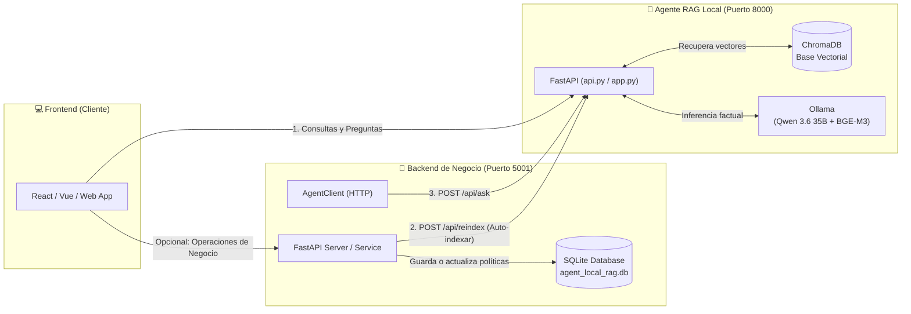

# 📖 Guía de Integración y Consumo de la API - AgentLocalRag

Esta guía describe cómo consumir la **API REST del Agente RAG Local (AgentLocalRag)** desde cualquier frontend (React, Vue, Angular, Mobile) o desde el **Backend Empresarial** desacoplado, incluyendo la funcionalidad de **auto-indexación programática**.

---

## 🏗️ 1. Arquitectura Desacoplada (Backend vs Agente RAG)

El sistema está organizado en dos componentes independientes que se comunican mediante HTTP REST:



1. **Agente RAG (`http://localhost:8000`)**: Servicio de inteligencia documental, vectorización y razonamiento estricto anti-alucinaciones.
2. **Backend de Negocio (`http://localhost:5001`)**: Administra la base de datos empresarial (`backend/db/agent_local_rag.db`). Cuando un dato cambia, le ordena al agente re-indexar por sí solo.

---

## 🚀 2. Puesta en Marcha

### Paso 1: Activar el entorno virtual
```bash
cd AgentLocalRag
source .venv/bin/activate
```

### Paso 2: Iniciar el Servidor del Agente RAG
```bash
python app.py
```
- **API URL:** `http://localhost:8000`
- **Swagger UI Interactivo:** `http://localhost:8000/docs`

### Paso 3: Iniciar el Backend Empresarial (Opcional en otra terminal)
```bash
python backend/server.py
```
- **Backend URL:** `http://localhost:5001`
- **Swagger UI del Backend:** `http://localhost:5001/docs`

---

## 📡 3. Catálogo de Endpoints de la API del Agente

### 3.1. Consulta Documental: `POST /api/ask`
Envía una pregunta en lenguaje natural y recibe la respuesta del agente junto con las fuentes, fecha y tiempo de ejecución.

- **URL:** `http://localhost:8000/api/ask` (o `/api/chat`)
- **Método:** `POST`
- **Headers:** `Content-Type: application/json`

#### Payload de Entrada (Request JSON):
```json
{
  "pregunta": "¿Cuál es la duración del turno nocturno de soporte técnico?",
  "session_id": "usuario_web_123",
  "reset_history": false
}
```

| Parámetro | Tipo | Requerido | Descripción |
|---|---|:---:|---|
| `pregunta` | `string` | **Sí** | Pregunta del usuario en lenguaje natural. |
| `session_id` | `string` | No | ID de sesión para conservar la memoria de la conversación (Default: `"default"`). |
| `reset_history` | `boolean` | No | Si es `true`, reinicia el historial de la conversación. |

#### Respuesta Exitosa (Response JSON - Código 200):
```json
{
  "status": "success",
  "pregunta": "¿Cuál es la duración del turno nocturno de soporte técnico?",
  "respuesta": "Según el Manual de Políticas y Procedimientos Internos de AgentLocalRag, la duración del turno nocturno es de 8 horas, operando desde las 22:00 hasta las 06:00.",
  "fuentes": [
    {
      "archivo": "manual_corporativo.txt",
      "fragmento": "1.2. El equipo de soporte técnico opera en turnos rotativos continuos de 8 horas: Turno Matutino (06:00 a 14:00), Turno Vespertino (14:00 a 22:00) y Turno Nocturno (22:00 a 06:00)...",
      "score": 0.3647
    }
  ],
  "fecha": "2026-10-30T14:39:00.069926+00:00",
  "tiempo_respuesta_segundos": 2.275,
  "modelo": "qwen3.6:35b",
  "session_id": "usuario_web_123"
}
```

> **Comportamiento ante temas fuera de alcance:** Si el usuario intenta hablar de temas externos o no documentados (ej: cocina, deportes, entretenimiento), el campo `fuentes` retornará una lista vacía `[]` y el agente frenará al usuario cordialmente recordando su alcance empresarial.

---

### 3.2. Auto-Indexación Programática: `POST /api/reindex`

Este endpoint permite que un backend de base de datos le ordene al agente **re-indexar la base vectorial automáticamente**, ejecutando por sí mismo el equivalente a:
```bash
python ingest.py --clean
```

- **URL:** `http://localhost:8000/api/reindex`
- **Método:** `POST`
- **Headers:** `Content-Type: application/json`

#### Opciones de invocación:

#### Opción A: Re-indexación simple de los archivos existentes en `data/`
```json
{
  "clean": true
}
```

#### Opción B: Actualización directa de contenido desde la Base de Datos
El backend puede enviar el archivo compilado desde su base de datos directamente en el cuerpo de la petición. El agente guarda el archivo en `data/` y se auto-indexa de inmediato:
```json
{
  "clean": true,
  "filename": "manual_corporativo.txt",
  "content": "# MANUAL ACTUALIZADO...\n1.1. Nueva política..."
}
```

#### Respuesta Exitosa (Response JSON - Código 200):
```json
{
  "status": "success",
  "mensaje": "Base vectorial re-indexada con éxito (2 fragmentos activos en ChromaDB).",
  "fragmentos_indexados": 2,
  "archivos_procesados": [
    "manual_corporativo.txt"
  ],
  "fecha": "2026-10-30T14:47:36.405337+00:00",
  "tiempo_ejecucion_segundos": 1.729
}
```

---

### 3.3. Listar Documentos Activos: `GET /api/documents`
Retorna los archivos almacenados en la carpeta `data/` del agente.

- **URL:** `http://localhost:8000/api/documents`
- **Método:** `GET`

```json
{
  "status": "success",
  "total_archivos": 1,
  "archivos": [
    {
      "archivo": "manual_corporativo.txt",
      "tamano_bytes": 2764,
      "ultima_modificacion": "2026-10-29T17:08:23.118743+00:00"
    }
  ],
  "directorio": "data"
}
```

---

### 3.4. Salud del Sistema: `GET /health`
- **URL:** `http://localhost:8000/health`
- **Método:** `GET`

```json
{
  "status": "healthy",
  "timestamp": "2026-10-30T14:39:00.067580+00:00",
  "modelo": "qwen3.6:35b",
  "embeddings": "bge-m3",
  "coleccion": "local_rag_collection",
  "fragmentos_activos": 2
}
```

---

## 💻 4. Ejemplos de Código para Consumir la API

### Desde JavaScript / TypeScript (Frontend con Fetch)

```javascript
// Función para enviar una pregunta al agente
async function consultarAgente(pregunta, sessionId = "cliente_01") {
  try {
    const response = await fetch("http://localhost:8000/api/ask", {
      method: "POST",
      headers: {
        "Content-Type": "application/json"
      },
      body: JSON.stringify({
        pregunta: pregunta,
        session_id: sessionId
      })
    });

    if (!response.ok) {
      throw new Error(`Error HTTP: ${response.status}`);
    }

    const data = await response.json();
    console.log("Respuesta del Agente:", data.respuesta);
    console.log("Fuentes utilizadas:", data.fuentes);
    console.log(`Tiempo de respuesta: ${data.tiempo_respuesta_segundos}s`);
    console.log("Fecha UTC:", data.fecha);
    
    return data;
  } catch (error) {
    console.error("Error al consultar el agente:", error);
  }
}

// Ejemplo de uso
consultarAgente("¿Cuánto es el límite para reembolso de libros técnicos?");
```

---

### Desde cURL (Terminal)

```bash
# Consulta al agente
curl -X POST http://localhost:8000/api/ask \
  -H "Content-Type: application/json" \
  -d '{
    "pregunta": "¿Cuántos días de permiso se otorgan por matrimonio?",
    "session_id": "curl_user"
  }'

# Ordenar al agente que auto-indexe
curl -X POST http://localhost:8000/api/reindex \
  -H "Content-Type: application/json" \
  -d '{"clean": true}'
```

---

## 🏢 5. Carpeta `backend/`: Desacoplamiento y Auto-Indexación

La carpeta `backend/` simula el sistema de gestión corporativo con su propia base de datos SQLite independiente.

### Estructura de `backend/`:
```text
backend/
├── db/
│   ├── database.py          # Gestión de SQLite (CRUD de políticas y compilador a Markdown)
│   └── agent_local_rag.db   # Base de datos SQLite persistente
├── agent_client.py          # Cliente HTTP hacia la API del Agente (ask, notify_reindex)
├── service.py               # Lógica de negocio: al guardar en BD -> notifica al Agente
├── server.py                # Servidor FastAPI del backend en puerto 5001
├── demo_sync.py             # Script de prueba del flujo completo
└── README.md                # Documentación del backend
```

### ¿Cómo funciona la auto-indexación cuando cambia un dato?

1. Un administrador o servicio actualiza un registro en la base de datos de `backend/`:
   ```python
   from backend.service import update_policy_and_autoindex

   # Cambia el subsidio de internet a 95 USD
   update_policy_and_autoindex(
       policy_id=4,
       nuevo_contenido="El subsidio mensual de conectividad es de 95 USD netos."
   )
   ```
2. La función `update_policy_and_autoindex`:
   - Guarda el nuevo valor en `backend/db/agent_local_rag.db`.
   - Compila el nuevo documento corporativo.
   - Envía una petición `POST http://localhost:8000/api/reindex` a la API del Agente.
3. El Agente RAG recibe la orden, limpia los fragmentos viejos de ChromaDB, indexa los nuevos vectores de inmediato y recarga su memoria en caliente.
4. Cualquier pregunta posterior reflejará el nuevo valor **sin necesidad de reiniciar ningún servidor**.

---

## 🧪 6. Demostración en Vivo (`demo_sync.py`)

Para ver la auto-indexación en acción con un solo comando, ejecuta:

```bash
# 1. Asegúrate de tener la API del agente corriendo en una terminal:
python app.py

# 2. En otra terminal ejecuta la demo del backend:
python backend/demo_sync.py
```

El script:
1. Pregunta al agente el valor del subsidio (responde `45 USD`).
2. Modifica la base de datos a `95 USD`.
3. Notifica al agente por la API para que se auto-indexe.
4. Vuelve a consultar al agente y muestra cómo responde inmediatamente `95 USD`.
5. Restaura el valor original.

