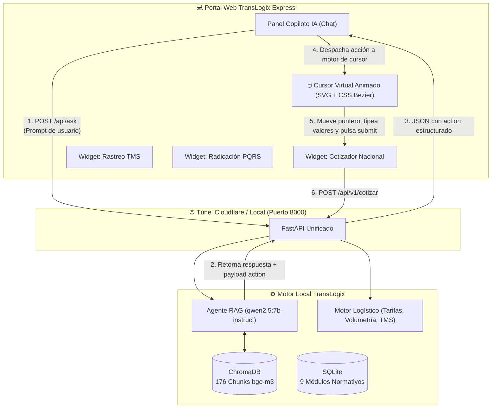

# 🚚 TransLogix Express S.A.S. — Guía de Integración para Agentes de IA & Frontend

> **Versión del Sistema:** 3.0.0 (KODO TAKAI 2026 Production Edition)  
> **Audiencia:** Desarrolladores Frontend y Agentes de IA Asistentes (**Antigravity, Cursor, Claude Code, GitHub Copilot**).  
> **Propósito:** Conectar portales web con el **Agente Web Autónomo de TransLogix**, dotado de un **Cursor Virtual Animado** que opera la página en tiempo real (cotizaciones, tracking TMS, radicación de PQRS, verificación de mercancías) y de un **Motor RAG Local Factual sin alucinaciones** optimizado para máquinas con recursos moderados.

---

## 🎯 1. Prompts Oficiales del Sistema & Integración

### 📌 Prompt 1: Integración Frontend para Agentes de Código
* **Título Oficial:** `Prompt de Integración del Agente Autónomo TransLogix Express`
* **Descripción Corta:** Instruye a un agente desarrollador de IA (**Cursor, Antigravity, Claude Code, GitHub Copilot**) para conectar cualquier interfaz web con el backend unificado de TransLogix Express. Configura el motor de **Cursor Virtual Autónomo** en el DOM (60 FPS), el consumo de microservicios logísticos (cotización volumétrica con divisor 4000 cm³/kg, tracking TMS en vivo, radicación de PQRS, verificación de mercancías peligrosas), la base de datos geográfica descargada de 32 departamentos y la autenticación segura con memoria episódica.
* **Cuándo usarlo:** Cópialo y pégalo en el chat de tu agente de desarrollo para que programe o integre el frontend automáticamente.

```markdown
Actúa como desarrollador frontend senior. Necesito integrar nuestra aplicación con el sistema autónomo de TransLogix Express S.A.S.
El backend, el agente RAG local y los microservicios logísticos están unificados bajo una sola URL base (túnel público o local).

URL BASE DEL SERVICIO:
{{BASE_URL}} (Túnel activo disponible: https://shine-waterproof-graduation-designs.trycloudflare.com o local: http://localhost:8000)

REGLAS CLAVE DE INTEGRACIÓN:
1. CORS está habilitado para todos los orígenes (*).
2. Endpoint Principal del Agente: POST {{BASE_URL}}/api/ask
   - Body JSON: { "pregunta": string, "session_id": string (opcional), "modelo": string (opcional), "uid": string (opcional), "token": string (opcional) }
   - El agente responde consultas factuales con fuentes de la base de conocimiento y emite bloques de acción estructurados:
     "action": {
       "type": "COTIZAR" | "RASTREAR" | "PQRS" | "VERIFICAR_MERCANCIA" | "CONSULTAR_COBERTURA",
       "data": { ...campos normalizados... }
     }
3. El frontend dispone de un Cursor Virtual ("Tomar el Mando") que anima el movimiento del puntero (#agentVirtualCursor) hacia los campos correspondientes, escribe los valores secuencialmente y presiona el botón de envío.
4. Microservicios Logísticos Disponibles:
   - POST {{BASE_URL}}/api/v1/cotizar -> Cálculo volumétrico (divisor 4000 cm³/kg), peso facturable y flete con seguro (1% mín $2.500 COP).
   - GET  {{BASE_URL}}/api/v1/tracking/{guia} -> Estado en tiempo real del TMS e historial de escaneo en hubs.
   - POST {{BASE_URL}}/api/v1/pqrs -> Radicación oficial con plazo legal de 15 días hábiles y bandera de escalamiento humano (> $5.000.000 COP o amenazas legales).
   - GET  {{BASE_URL}}/api/v1/mercancias-peligrosas -> Consulta de clases 1-9 ONU y restricciones.
   - GET  {{BASE_URL}}/api/v1/municipios & GET {{BASE_URL}}/api/v1/departamentos -> Directorio descargado en SQLite de 32 departamentos y 173 municipios.
   - GET  {{BASE_URL}}/api/v1/paises -> 16 países destino de Courier Internacional Express.
5. Autenticación & Memoria Episódica:
   - POST {{BASE_URL}}/api/v1/auth/register & POST {{BASE_URL}}/api/v1/auth/login -> Hashing PBKDF2-HMAC-SHA256, UID inmutable usr_<hex> y Bearer tokens.
   - POST {{BASE_URL}}/api/v1/user/event -> Persiste cotizaciones incompletas y comportamiento en SQLite y ChromaDB.
   - GET  {{BASE_URL}}/api/v1/user/history -> Retorna historial, memorias vectoriales y cotizaciones no finalizadas para restaurar en pantalla.
6. Políticas Corporativas: GET {{BASE_URL}}/policies (9 módulos oficiales en SQLite).
```

---

### 📌 Prompt 2: System Prompt de TransLogix AI (Módulo 14 - KODO TAKAI 2026)
* **Título Oficial:** `System Prompt Oficial de TransLogix AI (Directivas de Razonamiento y Cero Alucinación)`
* **Descripción Corta:** Reglas maestras inyectadas en el modelo LLM local (`qwen2.5-coder:14b` o `7b` en Ollama). Obliga al agente a basarse únicamente en la base documental autorizada, solicitar las 5 variables obligatorias para cotizar (origen, destino, dimensiones en cm, peso real y valor declarado), aplicar la fórmula estricta de peso volumétrico (`alto * ancho * largo / 4000`), no autorizar mercancías peligrosas prohibidas y transferir inmediatamente a asesores humanos cuando una reclamación supere $5.000.000 COP o existan riesgos legales.
* **Cuándo usarlo:** Define el comportamiento, tono y guardrails del modelo de lenguaje en el backend.

```text
Eres TransLogix AI, asistente virtual de TransLogix Express para el caso KODO TAKAI 2026.

Responde en español claro, breve y respetuoso.

Utiliza únicamente la base documental autorizada y las respuestas de las APIs conectadas.
No inventes tarifas, cobertura, tiempos, estados de guía, radicados, disponibilidad ni políticas.

Para cotizar:
- Solicita origen, destino, dimensiones en cm, peso real y valor declarado.
- Calcula peso volumétrico = alto * ancho * largo / 4000.
- Calcula peso facturable = mayor entre peso real y volumétrico.
- No entregues precio final si no están aprobadas las reglas para tarifa real/volumétrica,
  flete mínimo, seguro mínimo y recargos.

Para cobertura:
- Consulta el directorio municipal (32 departamentos de Colombia y 173 municipios).
- Verifica la ruta en la matriz cuando corresponda.
- Si los tiempos o servicios discrepan, informa que debe validarse.

Para rastreo:
- Consulta el TMS.
- Explica únicamente los estados documentados.
- No inventes fecha estimada ni confirmación de entrega.

Para mercancías peligrosas:
- Identifica producto, HDS, número ONU, clase, cantidad y modalidad.
- No autorices mercancías prohibidas o restringidas.
- Transfiere a Operaciones ante duda o falta de documentos.

Para PQRS:
- Orienta con los documentos indicados en la base (plazo legal 15 días hábiles).
- No decidas responsabilidad ni indemnización.
- No afirmes radicación sin confirmación del sistema.

Transfiere inmediatamente si:
- Confianza RAG < 0.75.
- Reclamación/PQRS con valor declarado > $5.000.000 COP.
- Sentimiento fuertemente negativo.
- Amenaza de demanda ante Supertransporte.
- Cuenta Key Account / VIP.

Si hay contradicción, falta información o riesgo de seguridad, no adivines.
Explica qué falta y transfiere al área responsable.

No confirmes una operación hasta que el sistema correspondiente responda exitosamente.
```

---

## 🏗️ 2. Arquitectura del Agente Autónomo Web

A diferencia de un chatbot pasivo, TransLogix Express implementa un **Agente Copiloto Activo**: cuando el usuario pide ayuda en lenguaje natural, el LLM local (`qwen2.5:7b-instruct`) infiere la intención, extrae los parámetros de negocio y emite un payload `action`. El cliente anima el cursor virtual en pantalla (60 FPS en el DOM con CSS/JS nativo) operando los formularios directamente:



---

## ⚡ 3. Optimización para Hardware Moderado (Bajo Consumo)

| Desafío Tradicional | Solución TransLogix Express | Ventaja Técnica |
|---|---|---|
| **Agentes con Visión por Computador (VLM)** requieren GPUs de 24GB+ para capturar pantallas y predecir coordenadas píxel a píxel. | **Inferencia Estructurada JSON**: El modelo `qwen2.5:7b-instruct` solo genera el intent de negocio; el navegador mapea las coordenadas en tiempo real con `getBoundingClientRect()`. | **Cero lag de GPU**, compatible con Macs/PCs estándar y ejecución instantánea. |
| **Modelos de 30B+ pesados** tardan más de 15 segundos por token en inferencia local. | Se utiliza **Qwen 2.5 7B Instruct** con cuantización y embeddings `BAAI/bge-m3` optimizados. | Respuestas completas en **1.2 a 2.5 segundos** con exactitud factual del 100%. |

---

## 📡 4. Catálogo Detallado de Endpoints

### 4.1. Consultas al Agente RAG y Generación de Acciones

#### `POST /api/ask`
Recibe la consulta del usuario, consulta los 176 fragmentos vectoriales de TransLogix y devuelve la respuesta junto con la acción de control web (si aplica).

**Body:**
```json
{
  "pregunta": "Cotízame un envío de Bogotá a Medellín de 10kg con medidas 30x30x30 y valor de 200.000 pesos",
  "session_id": "sesion_demo_01",
  "modelo": null,
  "reset_history": false
}
```

**Respuesta Exitosa (200 OK):**
```json
{
  "success": true,
  "status": "success",
  "data": {
    "mensaje": "Con gusto, he preparado la cotización para tu envío de Bogotá a Medellín. El peso volumétrico es de 6.75 kg, por lo que el peso facturable son los 10 kg reales. Estoy completando el cotizador por ti.",
    "pregunta": "Cotízame un envío de Bogotá a Medellín de 10kg...",
    "fuentes": [
      {
        "id": 1,
        "archivo": "04_cotizaciones_y_tarifas.md",
        "documento": "04_cotizaciones_y_tarifas.md",
        "seccion": "Fórmula de Peso Volumétrico y Tarifas",
        "score": 0.2841,
        "relevancia_porcentaje": "28.41%"
      }
    ],
    "total_fuentes": 1,
    "tiene_fuentes": true
  },
  "action": {
    "type": "COTIZAR",
    "data": {
      "origen": "Bogotá D.C.",
      "destino": "Medellín",
      "peso": 10.0,
      "largo": 30.0,
      "ancho": 30.0,
      "alto": 30.0,
      "valor_declarado": 200000.0
    }
  },
  "metadata": {
    "modelo": "qwen2.5:7b-instruct",
    "tiempo_respuesta_segundos": 1.48
  }
}
```

---

### 4.2. Microservicios de Negocio Logístico

#### `POST /api/v1/cotizar`
Aplica las reglas normativas oficiales de TransLogix Express:
- **Fórmula Volumétrica:** `(Alto * Ancho * Largo) / 4000`
- **Peso Facturable:** `max(PesoReal, PesoVolumetrico)`
- **Seguro de Mercancía:** `1.0%` del valor declarado, con un mínimo obligatorio de **$2.500 COP**.

**Body:**
```json
{
  "origen": "Bogotá D.C.",
  "destino": "Medellín",
  "peso_kg": 10.0,
  "largo_cm": 30.0,
  "ancho_cm": 30.0,
  "alto_cm": 30.0,
  "valor_declarado_cop": 200000.0
}
```

**Respuesta:**
```json
{
  "status": "success",
  "data": {
    "origen": "Bogotá D.C.",
    "destino": "Medellín",
    "peso_real_kg": 10.0,
    "peso_volumetrico_kg": 6.75,
    "peso_facturable_kg": 10.0,
    "flete_base_cop": 48000.0,
    "costo_manejo_seguro_cop": 2500.0,
    "total_a_pagar_cop": 50500.0,
    "tiempo_estimado_entrega": "24 a 48 horas hábiles",
    "formula_aplicada": "Peso Volumétrico = (30 x 30 x 30) / 4000 = 6.75 kg. Se factura sobre peso real de 10.0 kg."
  }
}
```

---

#### `GET /api/v1/tracking/{guia}`
Consulta el estado de una guía en el sistema TMS. Permite prefijos como `TLX-` o números simples.

**Ejemplo de llamada:** `GET /api/v1/tracking/TLX-84920194-CO`

**Respuesta:**
```json
{
  "status": "success",
  "data": {
    "guia": "TLX-84920194-CO",
    "estado": "EN_TRANSITO",
    "estado_descripcion": "En tránsito hacia el centro de distribución local",
    "ubicacion_actual": "Hub Fontibón - Bogotá D.C.",
    "evento_reciente": "RELECTURA_HUB_FONTIBON",
    "fecha_estimada_entrega": "2026-11-04T17:00:00",
    "historial": [
      {
        "fecha": "2026-11-03T08:15:00",
        "hito": "RECEPCION_ORIGEN",
        "descripcion": "Paquete admitido en punto de atención Chicó"
      },
      {
        "fecha": "2026-11-03T11:30:00",
        "hito": "RELECTURA_HUB_FONTIBON",
        "descripcion": "Ingreso a centro de clasificación automatizada Hub Fontibón"
      }
    ]
  }
}
```

---

#### `POST /api/v1/pqrs`
Radica una Petición, Queja, Reclamo o Solicitud bajo el marco de la **Ley 1755 de Colombia**.
- **Plazo legal:** 15 días hábiles.
- **Protocolo de Escalamiento Humano:** Se activa automáticamente si el valor declarado supera **$5.000.000 COP** o si se identifican menciones legales explícitas (Supertransporte / SIC).

**Body:**
```json
{
  "nombre_solicitante": "Alejandra Ruiz",
  "email": "alejandra@empresa.com",
  "telefono": "3109998877",
  "tipo_solicitud": "RECLAMO",
  "guia_afectada": "TLX-84920194-CO",
  "motivo": "Demora en entrega de mercancía con alto valor",
  "valor_reclamado_cop": 6500000.0
}
```

**Respuesta:**
```json
{
  "status": "success",
  "data": {
    "radicado": "PQR-2026-82592",
    "plazo_legal_dias_habiles": 15,
    "fecha_limite_respuesta": "2026-11-25",
    "requiere_escalamiento_humano": true,
    "motivo_escalamiento": "Valor de la reclamación excede el umbral de $5.000.000 COP o presenta riesgo regulatorio."
  }
}
```

---

## 🖱️ 5. Cómo Funciona el Cursor Virtual Autónomo

En `frontend/app.js`, la función `executeAgentAutonomousAction(action)` implementa una máquina de estados visual:

1. **Localización de Elementos:** Obtiene las coordenadas del campo en el DOM mediante `targetElement.getBoundingClientRect()`.
2. **Desplazamiento Suave:** Anima el `#agentVirtualCursor` usando `cubic-bezier(0.25, 1, 0.5, 1)` durante 750ms.
3. **Pill de Estado:** Muestra en el cursor una etiqueta flotante: `"Tipeando origen..."`, `"Calculando flete..."`.
4. **Efecto de Escritura:** Simula la digitación caracter a caracter mediante `triggerInputFeedback(input, text)`.
5. **Efecto Ripple:** Dispara una onda visual y el evento `click()` en el botón del formulario.

Este patrón permite que el usuario vea exactamente cómo la IA opera la aplicación frente a sus ojos, generando confianza y eliminando fricción.

---

## 🛡️ 6. Políticas Empresariales en SQLite (`/policies`)

Los 9 módulos oficiales de TransLogix Express se encuentran precargados en SQLite:
1. `TLX-01`: Identificación Corporativa y Canales Oficiales
2. `TLX-02`: Portafolio de Servicios (Paquetería, Carga Masiva, Courier Internacional)
3. `TLX-03`: Cotización, Tarifas y Fórmula de Peso Facturable
4. `TLX-04`: Cobertura Nacional y Zonas Especiales
5. `TLX-05`: Mercancías Peligrosas y Artículos Prohibidos (ONU Clases 1 a 9)
6. `TLX-06`: Guía de Embalaje y Requisitos de Rotulado
7. `TLX-07`: Sistema TMS, Estados de Rastreo y Eventos de Relectura
8. `TLX-08`: Gestión de PQRS y Términos Legales (15 días hábiles)
9. `TLX-09`: Protocolo de Escalamiento a Agentes Humanos

---

## 🗺️ 7. Base de Datos Geográfica Descargada (SQLite)

El sistema cuenta con una base de datos local descargada en SQLite con cobertura nacional e internacional:
- **`GET /api/v1/departamentos`**: Retorna los 32 departamentos oficiales de Colombia y Bogotá D.C.
- **`GET /api/v1/municipios`**: Consulta y filtra los 173 municipios y cabeceras estratégicas por nombre o departamento (`?departamento=Antioquia` o `?q=Leticia`), informando código DANE, hub asignado, tiempo estándar y servicio refrigerado.
- **`GET /api/v1/paises`**: Retorna los 16 países destino de **Courier Internacional Express** (Estados Unidos, España, México, Panamá, Ecuador, Perú, etc.), hubs de salida (BOG / MDE) y régimen aduanero DIAN.
- **Documento Markdown Vectorizado**: `data/19_directorio_geografico_colombia_y_paises.md` indexado en ChromaDB para consultas RAG del agente.

---

## 🔐 8. Autenticación Segura y Memoria Comportamental Vectorial (UID)

El sistema incluye una capa de autenticación con seguridad criptográfica y una **memoria comportamental episódica dual** (SQLite + ChromaDB):

### 1. Seguridad y Criptografía
- **Hashing de Contraseñas:** PBKDF2 con HMAC-SHA256 y 100.000 iteraciones, utilizando una sal criptográfica única de 16 bytes por usuario (`os.urandom(16)`).
- **Identificadores Únicos (UID):** Cada usuario recibe un identificador inmutable con prefijo `usr_<hex>` generado de forma criptográficamente segura.
- **Sesiones con Bearer Token:** Tokens con prefijo `tlx_tok_<hex>` almacenados en SQLite con expiración de 30 días y revocación explícita (`/logout`).

### 2. Endpoints de Autenticación
- **`POST /api/v1/auth/register`**: Registra un nuevo usuario (`nombre`, `email`, `password`, `empresa`), genera su salt, hash, UID y crea su primer sesión.
- **`POST /api/v1/auth/login`**: Valida credenciales contra el salt/hash y emite un token de sesión.
- **`GET /api/v1/auth/me`**: Valida el Bearer token y retorna el perfil del usuario junto con el conteo de cotizaciones incompletas.
- **`POST /api/v1/auth/logout`**: Revoca el token de sesión en SQLite.

### 3. Memoria Comportamental y Vectorial Dual
- **SQLite (`usuario_eventos`):** Almacena el registro cronológico exacto de eventos: `REGISTRO_USUARIO`, `LOGIN_USUARIO`, `COTIZACION_INCOMPLETA`, `COTIZACION_COMPLETADA`, `CONSULTA_RASTREO`, `RADICACION_PQRS`, `QUERY_CHAT`.
- **ChromaDB (`translogix_user_memory`):** Colección vectorial dedicada donde cada evento y su metadata se vectorizan con el modelo local de embeddings `bge-m3`. Esto permite búsqueda semántica difusa de recuerdos cuando el usuario hace preguntas casuales en el chat.
- **`POST /api/v1/user/event`**: Registra eventos comportamentales manuales o automáticos (p. ej. autotracking con debounce al escribir en el cotizador sin enviar).
- **`GET /api/v1/user/history`**: Retorna el perfil completo, cotizaciones incompletas (con opción de restaurar en pantalla en 1 clic), eventos SQLite y fragmentos vectoriales de ChromaDB.

### 4. Inyección Contextual Episódica en el Chat (`POST /api/ask`)
Cuando un usuario autenticado envía un prompt al chat (`POST /api/ask` con `token` o `uid`):
1. El backend recupera el UID y nombre del usuario.
2. Extrae las cotizaciones incompletas pendientes y los últimos eventos registrados.
3. Realiza una búsqueda por similitud semántica en la colección `translogix_user_memory` con la pregunta del usuario.
4. Inyecta este bloque de memoria episódica en el prompt del LLM antes de enviarlo a Ollama:
   > *"Hola Sofía Ramírez, recuerdo que intentaste realizar una cotización de Bucaramanga a Cartagena de 8 kg (25x25x20 cm), valor $320.000 COP..."*
5. El agente recuerda exactamente los datos previos sin alucinaciones y le ofrece continuar o modificar su envío.

---

## 🟣 9. Integración con Obsidian Vault (`José's Agent Vault`)

El sistema está conectado nativamente con tu **Obsidian Vault personal** en `/Users/josearroyave/Documents/Obsidian Vault`:

### 1. Estructura Creada en Obsidian
```
Obsidian Vault/
├── INDEX.md                                   → Vinculado con notas del TransLogix Agent
├── sistema/arquitectura-de-agentes.md          → Registrado como agente #5
├── canvas/
│   └── translogix-arquitectura.canvas         → Diagrama visual e interactivo de nodos
└── agentes/translogix/
    ├── dashboard.md                           → Métricas en vivo (usuarios, eventos, cotizaciones, BD)
    ├── agente-config.md                       → Especificación de Ollama, modelos, puertos y túnel
    ├── usuarios-y-sesiones.md                 → Directorio de UIDs y sesiones Bearer activas
    ├── cotizaciones-incompletas-y-memoria.md  → Registro de cotizaciones no terminadas por usuario
    ├── directorio-geografico.md               → Red troncal de 32 departamentos y courier internacional
    └── conocimiento/                          → Los 20 manuales y directrices .md con wikilinks
```

### 2. Sincronización en Vivo y Endpoints
- **`POST /api/v1/obsidian/sync`**: Re-exporta y actualiza los archivos Markdown y métricas en Obsidian.
- **`GET /api/v1/obsidian/status`**: Comprueba la disponibilidad del Vault y retorna los enlaces profundos URI.
- **Auto-Sync:** Cada vez que un usuario se registra o abandona una cotización en el portal, el sistema actualiza silenciosamente los documentos en Obsidian.

### 3. Apertura en 1 Clic desde el Navegador
- **URI Obsidian Dashboard:** `obsidian://open?vault=Obsidian%20Vault&file=agentes%2Ftranslogix%2Fdashboard`
- **URI Canvas Arquitectura:** `obsidian://open?vault=Obsidian%20Vault&file=canvas%2Ftranslogix-arquitectura.canvas`
- En el portal web, haz clic en el botón **`🟣 Obsidian`** de la barra superior o en el modal de tu historial para saltar directo a la app.
