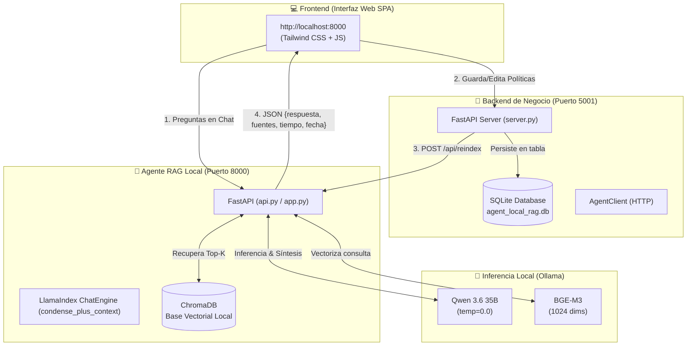

# 🛡️ AgentLocalRag - Sistema Inteligente & Auto-Indexación en Caliente

Sistema de **RAG (Retrieval-Augmented Generation) 100% Local**, desacoplado y de grado de ingeniería, con garantía de **cero alucinaciones**, memoria conversacional, guardrails estrictos de alcance institucional y **sincronización bidireccional en caliente** con la base de datos empresarial.

---

## 📑 Tabla de Contenidos

1. [🏗️ Arquitectura del Sistema](#-arquitectura-del-sistema)
2. [✨ Características Principales](#-características-principales)
3. [📁 Estructura del Repositorio](#-estructura-del-repositorio)
4. [⚙️ Modelos Utilizados y Cómo Cargarlos en Ollama](#-modelos-utilizados-y-cómo-cargarlos-en-ollama)
5. [🔧 Cómo Configurar o Cambiar los Modelos en el Código](#-cómo-configurar-o-cambiar-los-modelos-en-el-código)
6. [🚀 Guía de Instalación y Puesta en Marcha](#-guía-de-instalación-y-puesta-en-marcha)
   - [Paso 1: Entorno Virtual y Dependencias](#paso-1-entorno-virtual-y-dependencias)
   - [Paso 2: Iniciar el Agente RAG (Puerto 8000)](#paso-2-iniciar-el-agente-rag-puerto-8000)
   - [Paso 3: Iniciar el Backend Empresarial (Puerto 5001)](#paso-3-iniciar-el-backend-empresarial-puerto-5001)
   - [Paso 4: Abrir la Interfaz Web (Frontend)](#paso-4-abrir-la-interfaz-web-frontend)
   - [Paso 5: Modo Terminal CLI Interactivo](#paso-5-modo-terminal-cli-interactivo)
7. [🔄 Flujo de Auto-Indexación en Tiempo Real](#-flujo-de-auto-indexación-en-tiempo-real)
8. [📡 API REST y Contratos JSON](#-api-rest-y-contratos-json)

---

## 🏗️ Arquitectura del Sistema

El proyecto está diseñado bajo un esquema desacoplado de microservicios locales:



---

## ✨ Características Principales

- **Garantía Anti-Alucinaciones**: Parámetro `temperature=0.0` y directivas factuales estrictas. Si una consulta no está respaldada por los documentos, el agente frena la alucinación de inmediato.
- **Guardrail de Alcance Institucional**: Si el usuario intenta hablar de temas no documentados o externos (deportes, recetas, código externo, cultura general), el modelo detiene amablemente la conversación y redirige a las normativas de la empresa.
- **Memoria Conversacional Continua**: Modo `condense_plus_context` que permite preguntas de seguimiento (*"¿y el turno de la mañana?", "¿con cuánta antelación debo pedirlas?"*).
- **Auto-Indexación en Caliente**: Modificar un dato en la base de datos empresarial SQLite desencadena automáticamente la re-indexación limpia de ChromaDB y recarga la memoria del agente en menos de un segundo, sin reiniciar servidores.
- **Modal de Carga con Barra de Progreso**: La interfaz web muestra una barra de progreso animada en 4 etapas (*"Subiendo e Indexando"*) que se cierra automáticamente en cuanto el agente confirma la indexación.
- **Animación Organizacional en Terminal**: El CLI interactivo despliega un árbol en vivo con spinners dinámicos y cronómetro de ejecución.

---

## 📁 Estructura del Repositorio

```text
.
├── config.py                  # Configuración central (modelos, prompts, chunking, rutas)
├── core_setup.py              # Fábrica de LLM, Embeddings y conexión con ChromaDB
├── ingest.py                  # Pipeline de ingesta, chunking semántico y embeddings
├── query.py                   # CLI interactivo con árbol animado en terminal (Rich)
├── api.py                     # API REST del Agente con FastAPI, CORS y endpoints
├── app.py                     # Entrypoint principal para iniciar el Agente RAG
├── requirements.txt           # Dependencias de Python fijadas
├── API_GUIDE.md               # Guía exhaustiva de integración de la API REST
│
├── backend/                   # 🏢 SERVICIO DE BASE DE DATOS Y NEGOCIO
│   ├── server.py              # Servidor FastAPI del backend en puerto 5001
│   ├── service.py             # Lógica de sincronización automática (DB -> Agente)
│   ├── agent_client.py        # Cliente HTTP para comunicarse con el Agente
│   ├── demo_sync.py           # Demostración del ciclo completo de auto-indexación
│   ├── README.md              # Documentación del backend empresarial
│   └── db/
│       ├── database.py        # Gestor de base de datos SQLite y exportador
│       └── agent_local_rag.db  # Base de datos SQLite persistente
│
├── frontend/                  # 💻 INTERFAZ WEB REACTIVA (SPA)
│   ├── index.html             # UI en HTML5 + Tailwind CSS (Chat + Panel lateral)
│   ├── app.js                 # Lógica del cliente, llamadas HTTP y barra de progreso
│   └── README.md              # Guía de arquitectura frontend (Vanilla o React)
│
├── data/                      # 📄 DOCUMENTOS FUENTE DEL AGENTE
│   └── manual_corporativo.txt # Documento institucional base
│
└── chroma_db/                 # 🗄️ BASE VECTORIAL PERSISTENTE (generada localmente)
```

---

## ⚙️ Modelos Utilizados y Cómo Cargarlos en Ollama

El sistema utiliza dos modelos complementarios ejecutados de manera 100% local mediante **Ollama**:

| Rol | Modelo Recomendado | Justificación |
|---|---|---|
| **LLM (Razonamiento & Síntesis)** | `qwen3.6:35b` | Modelo Mixture-of-Experts (MoE) de 35.5B de parámetros (~3B activos) con extraordinaria capacidad de razonamiento profundo, fidelidad a directivas y alta velocidad. |
| **Embeddings Semánticos** | `bge-m3` | Estado del arte en recuperación densa multilingüe con espacio vectorial de 1024 dimensiones. |

### Cómo descargarlos en tu máquina:

Asegúrate de tener [Ollama](https://ollama.com/) instalado y en ejecución en tu sistema:

```bash
# 1. Descargar el modelo LLM Qwen 3.6 de 35B
ollama pull qwen3.6:35b

# 2. Descargar el modelo de Embeddings BGE-M3
ollama pull bge-m3
```

*(Opcional: Si cuentas con recursos limitados o prefieres un modelo denso, también puedes utilizar `qwen2.5-coder:32b`, `qwen2.5-coder:14b` o `qwen2.5:7b-instruct`).*

---

## 🔧 Cómo Configurar o Cambiar los Modelos en el Código

Toda la parametrización de modelos se centraliza en el archivo [`config.py`](config.py):

```python
# ==============================================================================
# CONFIGURACIÓN DEL SERVIDOR OLLAMA Y MODELOS
# ==============================================================================
OLLAMA_BASE_URL = os.getenv("OLLAMA_BASE_URL", "http://localhost:11434")

# LLM: Modelo local vía Ollama
LLM_MODEL = os.getenv("LLM_MODEL", "qwen3.6:35b")
LLM_TEMPERATURE = 0.0      # Determinismo absoluto para mitigar alucinaciones
REQUEST_TIMEOUT = 180.0    # Segundos de espera para inferencias locales

# EMBEDDINGS: BGE-M3
EMBEDDING_PROVIDER = os.getenv("EMBEDDING_PROVIDER", "ollama").lower()
EMBEDDING_MODEL_OLLAMA = os.getenv("EMBEDDING_MODEL_OLLAMA", "bge-m3")
```

### Cambiar de modelo sin tocar el código:
Puedes cambiar el modelo dinámicamente mediante variables de entorno antes de ejecutar:

```bash
export LLM_MODEL="qwen2.5:7b-instruct"
python app.py
```

---

## 🚀 Guía de Instalación y Puesta en Marcha

### Paso 1: Entorno Virtual y Dependencias

Clona el repositorio e instala los paquetes en un entorno virtual:

```bash
# 1. Clonar el repositorio
git clone https://github.com/JoseArroyave/AgentLocalRag.git
cd AgentLocalRag

# 2. Crear y activar el entorno virtual
python3 -m venv .venv
source .venv/bin/activate

# 3. Instalar dependencias
pip install -r requirements.txt
```

*(Opcional: Generar la base vectorial inicial con `python ingest.py --clean`).*

---

### Paso 2: Iniciar el Agente RAG (Puerto 8000)

En tu **Terminal 1**:

```bash
source .venv/bin/activate
python app.py
```

- **Servidor del Agente:** `http://localhost:8000`
- **Swagger UI Interactivo:** `http://localhost:8000/docs`
- **Frontend Integrado:** `http://localhost:8000/`

---

### Paso 3: Iniciar el Backend Empresarial (Puerto 5001)

En tu **Terminal 2**:

```bash
source .venv/bin/activate
python backend/server.py
```

- **Backend API:** `http://localhost:5001`
- **Swagger del Backend:** `http://localhost:5001/docs`

> **Nota sobre puertos:** En macOS, el puerto 5000 está reservado por el sistema para AirPlay Receiver. Por esta razón, el backend corporativo utiliza el puerto **`5001`**.

---

### Paso 4: Abrir la Interfaz Web (Frontend)

Con ambos servidores en marcha, abre en tu navegador:

👉 **`http://localhost:8000`**

*(También puedes abrir directamente [`frontend/index.html`](frontend/index.html) con doble clic en tu explorador de archivos).*

---

### Paso 5: Modo Terminal CLI Interactivo

Si prefieres interactuar con el agente directamente desde tu consola con el árbol organizacional animado:

```bash
python query.py
```

O para una consulta directa por argumento:
```bash
python query.py "¿Cuál es la duración del turno nocturno de soporte técnico?"
```

---

## 🔄 Flujo de Auto-Indexación en Tiempo Real

1. **Desde el Frontend**: Haz clic en el botón **"Modificar Base de Datos"**.
2. **Edición**: Escribe o modifica una política en el `<textarea>` (por ejemplo: cambiar un horario o monto de subsidio).
3. **Pulsar "Guardar en BD y Auto-Indexar"**:
   - Se despliega la **modal de carga con la barra de progreso animada** pasando por las 4 fases:
     1. Guarda en SQLite (`backend/db/agent_local_rag.db`).
     2. El Backend notifica a la API del Agente (`POST http://localhost:8000/api/reindex`).
     3. El Agente limpia ChromaDB y genera los nuevos embeddings BGE-M3.
     4. Al recibir el 200 OK del agente, la barra llega al 100% y la modal se cierra automáticamente.
4. **Verificación**: Pregunta en el chat sobre el dato que acabas de modificar. El agente te responderá al instante con el nuevo valor.

---

## 📡 API REST y Contratos JSON

### 1. `POST /api/ask` (Consulta al Agente)

#### Request:
```json
{
  "pregunta": "¿Cuál es la duración del turno nocturno de soporte técnico?",
  "session_id": "usuario_frontend_01"
}
```

#### Response:
```json
{
  "status": "success",
  "pregunta": "¿Cuál es la duración del turno nocturno de soporte técnico?",
  "respuesta": "La duración del turno nocturno de soporte técnico es de 8 horas, operando desde las 22:00 hasta las 06:00.",
  "fuentes": [
    {
      "archivo": "manual_corporativo.txt",
      "fragmento": "1.2. El equipo de soporte técnico opera en turnos rotativos continuos de 8 horas: Turno Matutino (06:00 a 14:00)...",
      "score": 0.3647
    }
  ],
  "fecha": "2026-10-30T14:39:00.069926+00:00",
  "tiempo_respuesta_segundos": 2.275,
  "modelo": "qwen3.6:35b",
  "session_id": "usuario_frontend_01"
}
```

### 2. `POST /api/reindex` (Auto-Indexación)

```bash
curl -X POST http://localhost:8000/api/reindex \
  -H "Content-Type: application/json" \
  -d '{"clean": true}'
```

Consulta [`API_GUIDE.md`](API_GUIDE.md) para ver ejemplos en Fetch, Axios, Python y cURL.

---

## 📄 Licencia

Este proyecto se distribuye bajo la licencia Apache 2.0. Desarrollado con LlamaIndex, Ollama, ChromaDB, FastAPI y Tailwind CSS.
